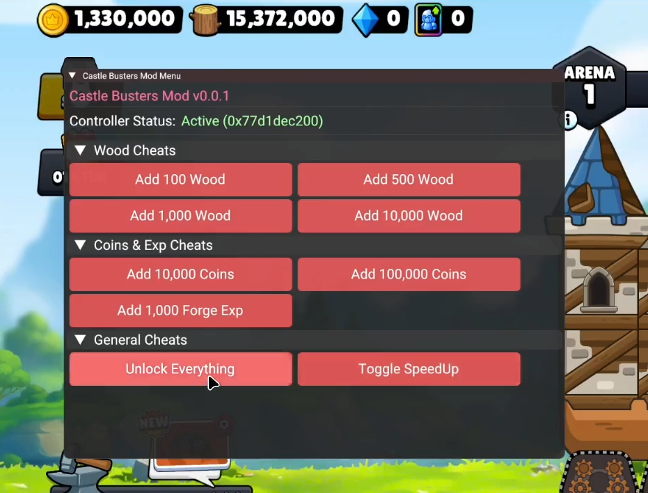

# il2cpp-base

A minimal Android cheat / mod base for Unity IL2CPP games using ImGui, BNM-Android, and Dobby.



## Usage Example
`BNMHelper` simplifies interacting with il2cpp classes, resolving instances, and calling methods without hardcoding their signatures:

```cpp
#include "utils/BNMHelper.h"

// target il2cpp class (Namespace, ClassName)
static BNMHelper::ClassWrapper<BNM::IL2CPP::Il2CppObject> controller("CastleClashers.Core", "DebugController");

// initialize class lookup
controller.init();

// call methods directly (automatically resolve instance & handle parameters)
controller.call("AddWood", 100);
controller.call("UnlockEverything");
```

## Building

Build the project directly using the NDK:

```bash
ndk-build
```

The output `libreversed.so` shared library will be generated in `libs/[ABI]/`.